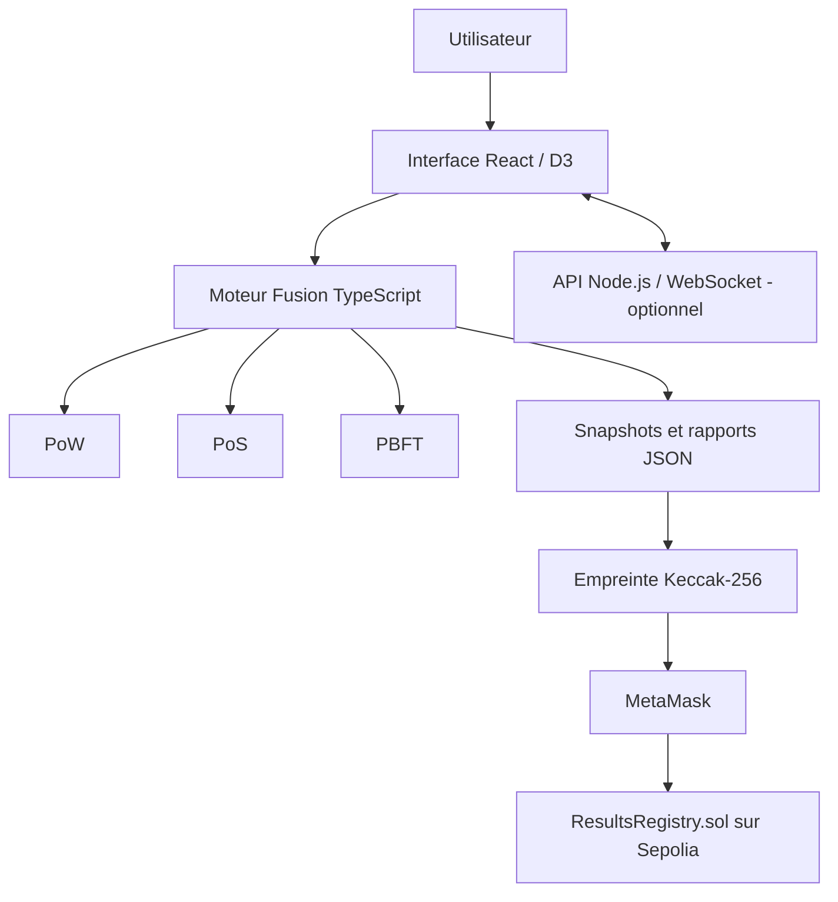
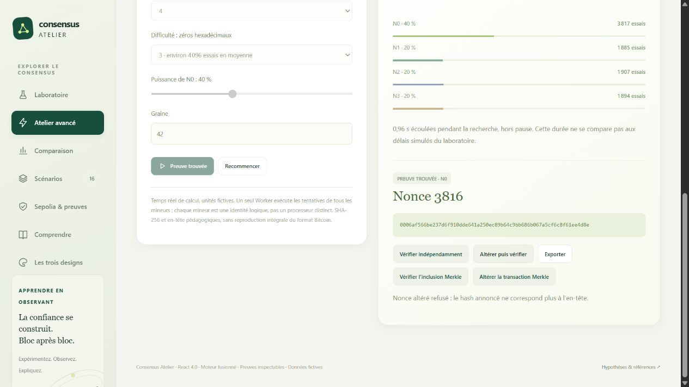
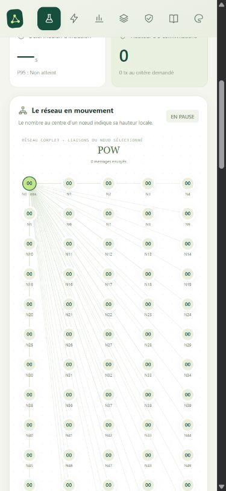
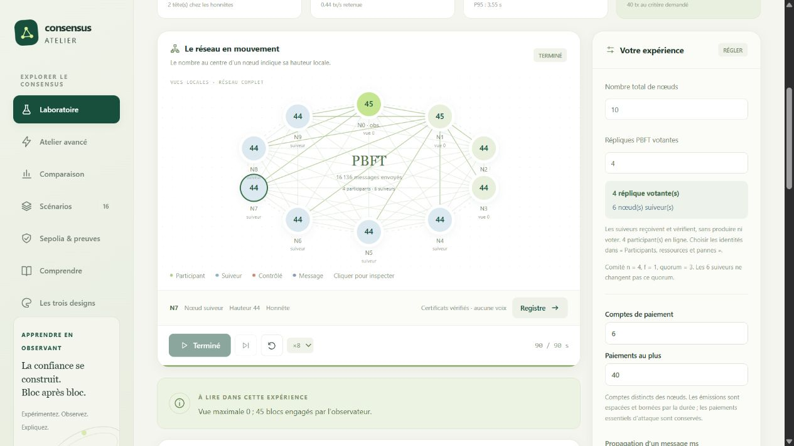
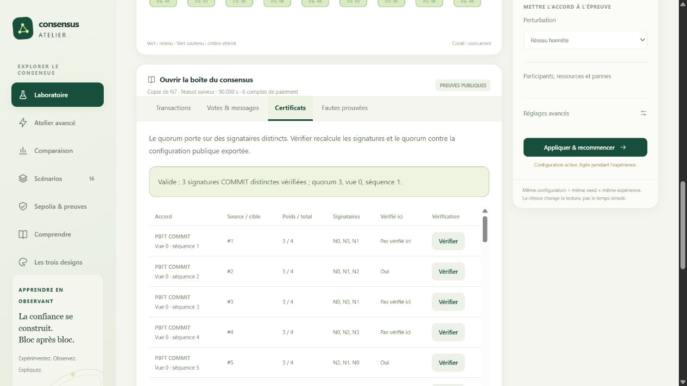
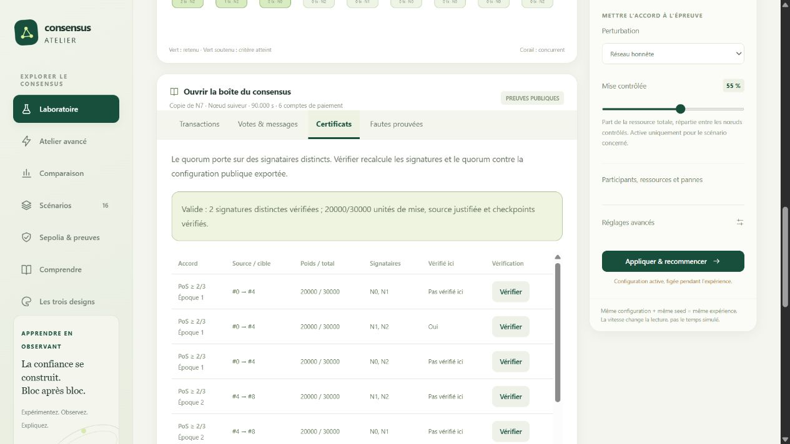

# Consensus Atelier — Blockchain Consensus Lab

**Laboratoire pédagogique interactif de simulation, d'analyse et de comparaison des consensus PoW, PoS et PBFT.**

    

**Démonstration publique :** https://  
**Dépôt GitHub :** `https://github.com/benikams03/blockchain-consensus-lab`

## 1. Membres du groupe

| Membre |
|---|
| MUMBE DIANTUADI Benjamin |
| N'SANDUNU MUKALA Esther |
| MUKUNGULU KAMUIMBA Beni |
| THEYTHEU KAMBALE Divin |

## 2. Objectifs

- Expliquer et comparer **Proof of Work (PoW)**, **Proof of Stake (PoS)** et **Practical Byzantine Fault Tolerance (PBFT)**.
- Visualiser les nœuds, producteurs, validateurs, répliques votantes et suiveurs.
- Étudier les fourches, pannes, partitions, doubles dépenses, votes et certificats.
- Mesurer les comportements des protocoles dans des scénarios reproductibles.
- Exporter des rapports JSON et ancrer leur empreinte sur Ethereum Sepolia.
- Distinguer la preuve d'enregistrement sur chaîne de la vérification scientifique hors chaîne.

## 3. Architecture



| Répertoire | Rôle |
|---|---|
| `src/core/` | Types, configuration, primitives, transactions et registres |
| `src/fusion/` | Moteur de simulation et adaptation des protocoles |
| `src/consensus/` | Implémentations PoW, PoS et PBFT |
| `src/advanced/` | Ateliers de minage, staking et analyses |
| `src/web/` | Interface React, pages, graphiques, Workers |
| `src/blockchain/` | Préparation des empreintes et interaction avec Sepolia |
| `server/` | API HTTP, sessions et WebSocket |
| `smart-contracts/` | Contrat Solidity et tests Hardhat |
| `tests/` | Tests applicatifs et de protocoles |
| `deployment/` | Métadonnées de déploiement et vérification |
| `artifacts/` | Rapports, traces de tests et captures |
| `docs/` | Documentation détaillée |

**Précision :** le navigateur peut exécuter le réseau logique sans backend. Les processus PBFT distribués avancés nécessitent le serveur. Le PoW du réseau est simulé ; l'atelier de minage calcule réellement des empreintes SHA-256. Les mises PoS sont fictives.

## 4. Prérequis et installation

- Node.js **22 ou supérieur** (Node 24 également pris en charge).
- npm, Git et navigateur moderne.
- MetaMask uniquement pour les opérations Sepolia.

```bash
git clone https://github.com/ORGANISATION/blockchain-consensus-lab.git
cd blockchain-consensus-lab
npm ci
npm run contracts:compile
npm run build
npm start
```

Ouvrir **http://127.0.0.1:4173**.

Pour le développement :

```bash
npm run dev
```

*Ce script reconstruit puis démarre l'application, sans hot reload automatique.*

Variables d'environnement disponibles dans `.env.example` :

```dotenv
PORT=4173
HOST=127.0.0.1
ALLOWED_ORIGINS=https://votre-interface.vercel.app
```

## 5. Contrat intelligent et adresses

**Contrat :** `smart-contracts/contracts/ResultsRegistry.sol`  
**Version :** Solidity `0.8.28`  
**Réseau de test :** Ethereum Sepolia — `chainId: 11155111`  
**Réseau local Hardhat :** `chainId: 31337`

| Information | Valeur |
|---|---|
| Contrat | `ResultsRegistry` |
| Adresse Sepolia | **Non déployé / à renseigner** |
| Transaction de déploiement | **À renseigner après confirmation** |
| Vérification du code sur Etherscan | **En attente** |
| Compte déployeur public | **À renseigner** |

Une fois le contrat déployé, mettre à jour `deployment/sepolia.json` et fournir le lien `https://sepolia.etherscan.io/address/ADRESSE_REELLE`.

### Fonctions principales

- `recordRun(...)` : enregistre l'empreinte et les métadonnées d'une expérience.
- `resultId(...)` : calcule l'identifiant dépendant de l'auteur et de l'empreinte.
- `getResult(...)` : lit une déclaration existante.
- `verify(...)` : compare une empreinte à une déclaration enregistrée.
- `totalRecords()` : renvoie le nombre d'enregistrements.

**Limite :** le contrat ne rejoue pas le consensus et ne certifie pas la validité scientifique du rapport ; il atteste l'enregistrement d'une déclaration associée à une empreinte.

## 6. Déploiement

### Interface statique (Vercel)

1. Importer le dépôt GitHub dans Vercel.
2. Configurer la commande de construction : `npm ci && npm run contracts:compile && npm run build`.
3. Publier le répertoire `dist/` avec la configuration `vercel.json` fournie.
4. Tester les Workers, l'interface et la connexion MetaMask dans le navigateur.

### Serveur API (Render / Railway)

Les fichiers `render.yaml` et `railway.json` sont fournis. Construire l'application puis démarrer avec `npm start` ; configurer `HOST=0.0.0.0`, `PORT` selon l'hébergeur et `ALLOWED_ORIGINS` avec l'origine HTTPS exacte du frontend.

Contrôle de santé : `GET /api/health`. Utiliser HTTPS/WSS en public. Les sessions sont conservées en mémoire, pas dans une base persistante.

### Déploiement du contrat sur Sepolia

1. Installer MetaMask, sélectionner Sepolia et obtenir des ETH de test.
2. Ouvrir la page **Sepolia & preuves** de l'application.
3. Connecter MetaMask et cliquer sur **Déployer avec MetaMask**.
4. Confirmer la transaction et attendre son reçu.
5. Reporter l'adresse et le hash de transaction dans `deployment/sepolia.json`.
6. Vérifier le code sur Sepolia Etherscan avec `deployment/verification-input.json` (Solidity 0.8.28, optimiseur 200, EVM Paris).
7. Reconstruire et republier l'interface.

Guide complet : [docs/SEPOLIA.md](docs/SEPOLIA.md).

## 7. Tests et vérifications

```bash
npm run check           # Contrôle des types TypeScript
npm test                # Tests applicatifs et protocolaires
npm run contracts:test  # Tests du smart contract Hardhat
npm run build           # Construction frontend + backend
npm run verify          # Vérification complète
```

Les scénarios de test portent notamment sur les registres, les signatures, les rôles des nœuds, les quorums, les fourches, la résilience, les sessions HTTP/WebSocket et les contraintes du contrat.

Les journaux de vérification précédents figurent dans `artifacts/`. Un contrôle Slither est également documenté dans [docs/SECURITE.md](docs/SECURITE.md). **Relancer les tests sur votre environnement avant la remise** : les anciens journaux ne remplacent pas une exécution actuelle.

## 8. Captures d'écran

### Minage et preuve Merkle


### Simulation sur mobile — 64 nœuds


### Réseau de 10 nœuds dont 4 votants


### Certificat PBFT du nœud suiveur


### Certificat PoS du nœud suiveur


## 9. Comptes de démonstration

| Accès | Compte / identifiant | Mode d'utilisation |
|---|---|---|
| Interface de simulation | **Aucun compte requis** | Ouvrir l'application dans un navigateur |
| Nœuds PoW/PoS/PBFT | Identités simulées générées par le laboratoire | Choisir les rôles dans le formulaire de configuration |
| MetaMask Sepolia | **Adresse publique du compte de test : à renseigner** | Connexion avec son propre portefeuille de test |
| API HTTP | Jeton temporaire de session | Obtenu à la création d'une session, ne pas publier |

**Aucun mot de passe, clé privée ou phrase de récupération ne doit être publié dans le dépôt.** Les identités simulées ne sont pas des comptes Ethereum réels.

## 10. Démonstration recommandée

1. Lancer un réseau honnête et inspecter les blocs et les transactions.
2. Provoquer une fourche et une tentative de double dépense en PoW.
3. Comparer les votes, la justification et la finalité en PoS.
4. Tester un leader silencieux et une partition PBFT.
5. Visualiser le minage SHA-256, les preuves Merkle et les mises fictives.
6. Exporter un rapport JSON ; après déploiement Sepolia, enregistrer puis vérifier son empreinte.

## 11. Documentation et limites

- [Architecture](docs/ARCHITECTURE.md)
- [Modèle et hypothèses](docs/MODELE.md)
- [Rôles des nœuds](docs/ROLES_NOEUDS.md)
- [Déploiement](docs/DEPLOIEMENT.md)
- [Sécurité](docs/SECURITE.md)
- [Guide de soutenance](docs/SOUTENANCE.md)
- [Notices et attributions](NOTICES.md)

Ce projet est **pédagogique** : les identités de simulation sont reproductibles et ne doivent pas protéger de vrais actifs. Le registre sur Sepolia prouve la correspondance d'une empreinte avec une déclaration publiée, pas l'exactitude de l'exécution hors chaîne.

## 12. Licence et attribution

Consulter [NOTICES.md](NOTICES.md) pour l'origine des composants et leurs adaptations. **Ne pas annoncer de licence globale sans validation des auteurs et des droits associés.**
