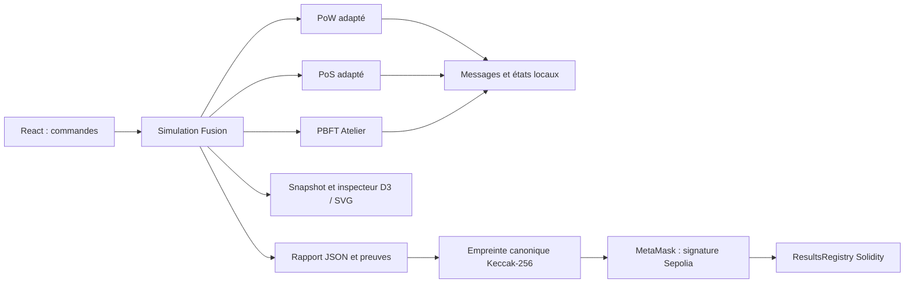

# Architecture — Fusion 4

Le rendu ne choisit jamais le producteur. Les moteurs ignorent React et le DOM. Les Workers exécutent comparaison et séries hors du fil principal. L’API Node utilise la même façade que le navigateur.

## Dépendances

- src/core/types.ts et config.ts : vocabulaire partagé, bornes et validation ; registre/primitives dans le même dossier.
- src/fusion/engine.ts : ressources et paiements, sélection du moteur, événements/mesures normalisés, inspection et export.
- src/fusion/vendor/ : PoW/PoS adaptés du camarade, messages typés, registres locaux, ordonnanceurs et cryptographie noble sans identité privée importée.
- src/core/engine.ts et src/consensus/pbft/ : réseau logique PBFT, vues et certificats. PoW/PoS historiques restent pour référence/régressions ; le laboratoire courant utilise Fusion.
- src/fusion/verification.ts : signatures/quorums publics ; domaine PoS recalculé avec mises, clés et état genesis pour détecter une modification.
- src/web/ : composants, pédagogie, Workers et hook useSimulation qui coordonne lecture/pause/mode distant.
- src/advanced/ : Miner/Miser distincts, relecture et agrégats ; src/distributed/ et server/distributed/ : processus locaux.
- server/index.ts : HTTP, API, WebSocket, sessions isolées, tailles et origines contrôlées.
- smart-contracts/ et src/blockchain/ : Solidity, tests, empreinte et garde Sepolia ; deployment/verification-input.json : compilation vérifiable.

## Formats et décisions

Le format interne conserve en-têtes/messages/signatures du protocole. Le snapshot normalisé dessine l’interface : ses blocs sont des projections. Le rapport garde trace/snapshot et proofRecord original, plus les certificats PBFT. Pour vérifier une signature, utiliser l’objet original signé, jamais le bloc de dessin reconstruit.

Chaque nœud possède blocs reçus, tête, registre, transactions et votes. La vue globale expose les branches privées pour enseigner sans fournir de vérité aux nœuds. L’observateur des métriques est fixé à la création, indépendamment du nœud inspecté.

Sur Node, chaque session contient la même Simulation et un jeton temporaire. Les commandes idempotentes évitent le double pas retransmis ; WebSocket pousse les snapshots. Les jetons ne sont pas des clés de consensus et ne doivent pas être publiés. Les processus PBFT avancés ont leur propre horloge réelle, plusieurs PID/ports sur une même machine : ils ne remplacent pas le réseau comparatif.

## Chaîne et hors chaîne

Sepolia conserve auteur, empreinte, protocole, compteurs, durée et événement. Le rapport, comptes fictifs, votes et graphes restent hors chaîne. Le contrat n’exécute pas le moteur et ne vérifie pas ses certificats ; il enregistre la déclaration d’un auteur sans écrasement possible. Le lecteur conserve le fichier correspondant.

Solidity 0.8.28, optimiseur 200, EVM Paris. ABI/bytecode React générés automatiquement ; MetaMask utilise les clés sans les remettre à l’application ou à un serveur de déploiement.

## Rôles — édition 4.1

nodeCount décrit le réseau total ; consensusNodes liste les participants. Les autres vérifient comme suiveurs. core/participants.ts centralise les poids et contrôlés ; Snapshot.nodes[].participates expose le rôle. PBFT calcule leaders, f et quorums sur ce comité et rejette les votes extérieurs. Le formulaire choisit total, nombre et identités. Voir docs/ROLES_NOEUDS.md et tests/roles.test.ts.
